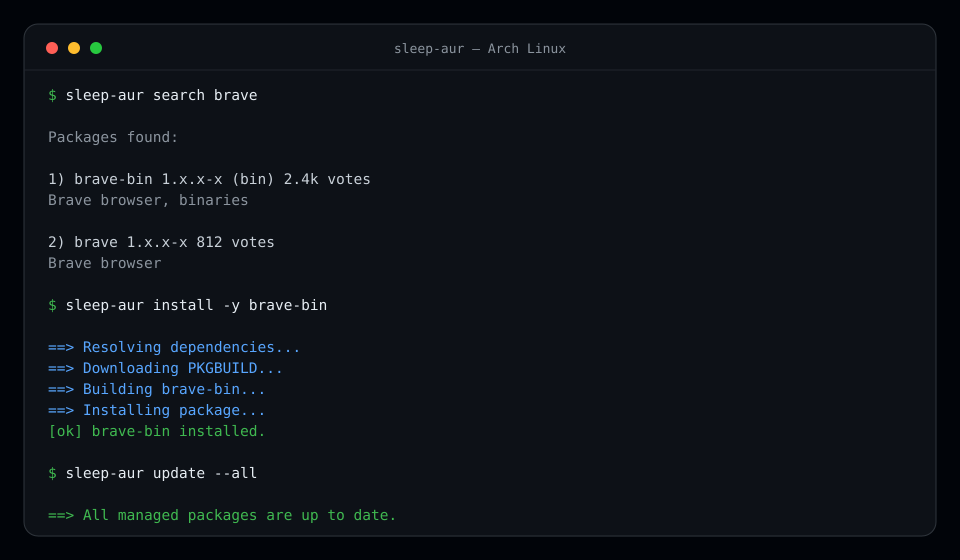

# sleep-aur

[](https://github.com/the-sleepless/sleep-aur/actions/workflows/ci.yml)
[](https://github.com/the-sleepless/sleep-aur/releases/latest)
[](LICENSE)
[](https://www.gnu.org/software/bash/)

> **A minimalist, auditable AUR helper for Arch Linux.**

sleep-aur installs, updates, and removes packages from the [Arch User Repository](https://aur.archlinux.org/) without hiding what is happening. It is designed to be easy to audit, simple to maintain, and clean on your system.

- Search the AUR with package versions, descriptions, and votes.
- Resolve repository and AUR dependencies, including recursive AUR dependencies.
- Handle split packages correctly and register every generated package.
- Keep a JSON database of managed packages.
- Build in temporary directories and clean up automatically on failures or Ctrl+C.
- Keep persistent build logs with rotation.
- Use a lock file to prevent concurrent runs.
- Install from checksum-verified GitHub releases.
- Provide both a command-line interface and an interactive shell.

<p align="center">
  
</p>

## Why sleep-aur?

Most AUR helpers are large applications. sleep-aur deliberately stays small and auditable:

- Written in Bash, with no `eval` and a small code surface.
- Packages are tracked in a readable JSON database, not an opaque format.
- Builds happen in temporary directories and are cleaned automatically.
- The installer and the release archive are verified with SHA-256.
- Follows the XDG base directory specification.
- Handles split packages and recursive AUR dependencies.
- Lets you review a `PKGBUILD` with `--edit` or `SLEEP_AUR_REVIEW=1`.

If you need advanced features such as binary repository support or parallel builds, mature helpers like `yay` or `paru` may be a better fit. sleep-aur focuses on being easy to read, audit, and maintain.

## At a glance

| | |
| --- | --- |
| Language | Bash 5+ |
| Package database | JSON |
| AUR dependency resolution | Recursive |
| Split packages | Yes |
| PKGBUILD review | `--edit`, `SLEEP_AUR_REVIEW=1` |
| Installer verification | SHA-256 |
| Configuration | XDG base directory |

---

## Installation

### Latest release

The installer lives at the repository root and downloads the code from GitHub Releases:

```bash
curl -fsSL https://github.com/the-sleepless/sleep-aur/releases/latest/download/installer.sh -o /tmp/installer.sh
less /tmp/installer.sh
bash /tmp/installer.sh
```

Avoid `curl ... | bash`. Download the installer, inspect it, and then run it.

On Arch Linux, if `git`, `jq`, or the `base-devel` group are missing, the installer asks whether it should install them with `pacman` before continuing.

sleep-aur only supports Arch Linux and derivatives. The release installer exits early on other distributions.

If sleep-aur is already installed, the installer compares the installed version with the target release. It exits without changing anything when they match, and updates otherwise.

The default installation paths are:

```text
/usr/local/bin/sleep-aur
/usr/local/lib/sleep-aur/
```

To use a different prefix:

```bash
bash /tmp/installer.sh --prefix "$HOME/.local"
```

### From source

From this checkout:

```bash
./installer.sh --local
```

This installs the working tree from `src/` instead of downloading a release.

To uninstall:

```bash
./installer.sh --uninstall
./installer.sh --uninstall --purge
```

---

## Usage

```text
sleep-aur [global options] <command> [arguments]
sleep-aur
```

### Commands

| Command | Description |
| --- | --- |
| `install <package...>` | Search, build, and install AUR packages. |
| `remove <package...>` | Remove packages managed by sleep-aur. |
| `remove --list` | Open the interactive removal menu. |
| `update [--all] [package...]` | Update managed AUR packages. |
| `update --devel` | Rebuild `*-git` packages as well. |
| `search <term>` | Search the AUR. |
| `info <package...>` | Show AUR package details. |
| `list [--orphans]` | List managed packages or orphan packages. |
| `clean <target...>` | Clean builds, logs, orphans, or the pacman cache. |
| `logs [package]` | Open build logs. |
| `self version` | Show the installed version. |
| `self path` | Show the directories in use. |
| `self update` | Download and run the latest installer. |
| `self uninstall` | Remove the current installation. |

### Examples

```bash
sleep-aur search brave
sleep-aur info brave-bin
sleep-aur install brave-bin
sleep-aur install -y brave-bin
sleep-aur install --edit spotify
sleep-aur install --dry-run visual-studio-code-bin
sleep-aur update --all
sleep-aur list
sleep-aur list --orphans
sleep-aur logs
sleep-aur remove --list
sleep-aur clean builds logs
```

`install -y <package>` installs an exact package name without showing the search menu and without confirmation prompts.

`install --edit <package>` opens the `PKGBUILD` in your editor before building.

### Global options

| Option | Effect |
| --- | --- |
| `-y`, `--noconfirm` | Do not ask for confirmation. |
| `--dry-run` | Show what would be done without changing the system. |
| `-v`, `--verbose` | Show the full `makepkg` output. |
| `-q`, `--quiet` | Suppress informational messages. |
| `--no-color` | Disable colors. |
| `-V`, `--version` | Show the version. |
| `-h`, `--help` | Show help. |

### Interactive mode

Run `sleep-aur` without arguments:

```text
aur> search brave
aur> install brave-bin
aur> list
aur> exit
```

Inside the interactive shell, `search` only lists packages. Use `install <name>` to open the selection menu, or `install -y <name>` to install an exact package directly.

---

## How it works

1. Resolve the AUR `PackageBase`.
2. Clone the repository with `git clone --depth 1`.
3. Read dependencies with `makepkg --printsrcinfo`.
4. Install repository dependencies and recursive AUR dependencies.
5. Build with `makepkg`.
6. Discover generated packages with `makepkg --packagelist`.
7. Install packages with `pacman -U`.
8. Register every generated `pkgname` in the JSON database.
9. Remove the temporary directory unless `KEEP_BUILDS=1` is set.

Split packages are installed together. Generated debug packages are skipped unless `INSTALL_DEBUG=1`.

Existing manifests from the old `~/.local/share/sleep-aur/installed/` layout are migrated automatically to the new JSON database.

---

## Project layout

```text
.
├── installer.sh
├── src/
│   ├── sleep-aur
│   ├── VERSION
│   └── lib/
│       ├── core.sh
│       ├── ui.sh
│       ├── manifest.sh
│       ├── aur.sh
│       ├── pkg.sh
│       └── commands.sh
├── tests/
├── .github/workflows/
├── README.md
└── LICENSE
```

---

## Directories

sleep-aur follows the XDG base directory specification:

| Purpose | Path |
| --- | --- |
| Configuration | `${XDG_CONFIG_HOME:-~/.config}/sleep-aur/config` |
| Package database | `${XDG_STATE_HOME:-~/.local/state}/sleep-aur/db/` |
| Logs | `${XDG_STATE_HOME:-~/.local/state}/sleep-aur/logs/` |
| Temporary builds | `${XDG_CACHE_HOME:-~/.cache}/sleep-aur/build/` |
| Lock file | `${XDG_RUNTIME_DIR:-...}/sleep-aur/lock` |

The installer does not remove state, databases, or logs when updating.

---

## Configuration

Create the configuration file:

```bash
mkdir -p "${XDG_CONFIG_HOME:-$HOME/.config}/sleep-aur"
$EDITOR "${XDG_CONFIG_HOME:-$HOME/.config}/sleep-aur/config"
```

Example configuration:

```bash
SUDO_CMD=sudo
KEEP_BUILDS=0
LOG_RETENTION=20
INSTALL_DEBUG=0
MAKEPKG_FLAGS=(-c --noconfirm)
AUR_RPC=https://aur.archlinux.org/rpc
SLEEP_AUR_REVIEW=0
UPDATE_CHECK=1
UPDATE_CHECK_INTERVAL=7200
```

| Variable | Description |
| --- | --- |
| `SUDO_CMD` | Privilege escalation command compatible with `sudo -v`. |
| `KEEP_BUILDS` | Keep the build directory after completion. |
| `LOG_RETENTION` | Number of build logs to keep. |
| `INSTALL_DEBUG` | Install generated debug packages when set to `1`. |
| `MAKEPKG_FLAGS` | Extra flags passed to `makepkg`. |
| `AUR_RPC` | AUR RPC endpoint. |
| `SLEEP_AUR_REVIEW` | Review the `PKGBUILD` before every build when set to `1`. |
| `UPDATE_CHECK` | Check for a new sleep-aur release when running commands (default: `1`). |
| `UPDATE_CHECK_INTERVAL` | Seconds between update checks (default: `7200`, or 2 hours). |

The configuration file is loaded as shell code and belongs to the user. Review third-party configuration before using it.

---

## Security

- The AUR contains user-submitted content. Review the `PKGBUILD` for unknown packages, especially before the first installation.
- Use `--edit` or set `SLEEP_AUR_REVIEW=1` to review packages before building.
- The installer downloads releases over HTTPS and verifies SHA-256 checksums before installing.
- The helper does not use `eval` and validates package names before using them in paths and commands.
- `makepkg` runs as the user, never as root.
- The installer refuses to overwrite a `sleep-aur` binary owned by a pacman package.

To report a vulnerability privately, see [SECURITY.md](SECURITY.md).

---

## Development

Requirements:

- Arch Linux or a derivative
- Bash 5+
- `base-devel`, `git`, `jq`, `curl`

Run the smoke tests:

```bash
./tests/smoke.sh
```

Validate syntax:

```bash
bash -n installer.sh
bash -n src/sleep-aur
bash -n src/lib/*.sh
bash -n packaging/aur/PKGBUILD
```

Lint:

```bash
sudo pacman -S --needed shellcheck
shellcheck -x installer.sh src/sleep-aur src/lib/*.sh tests/smoke.sh
```

---

## Releases

The release workflow at `.github/workflows/release.yml` runs on `v*` tags:

```bash
git tag v3.1.0
git push origin v3.1.0
```

It publishes:

- `sleep-aur.tar.gz`
- `sleep-aur.tar.gz.sha256`
- `installer.sh`
- `installer.sh.sha256`

The installer downloads `releases/latest/download/sleep-aur.tar.gz` and verifies the matching checksum.

---

## Contributing

Issues and pull requests are welcome. See [CONTRIBUTING.md](CONTRIBUTING.md) for local setup, tests, and guidelines.

---

## License

MIT. See [LICENSE](LICENSE).
